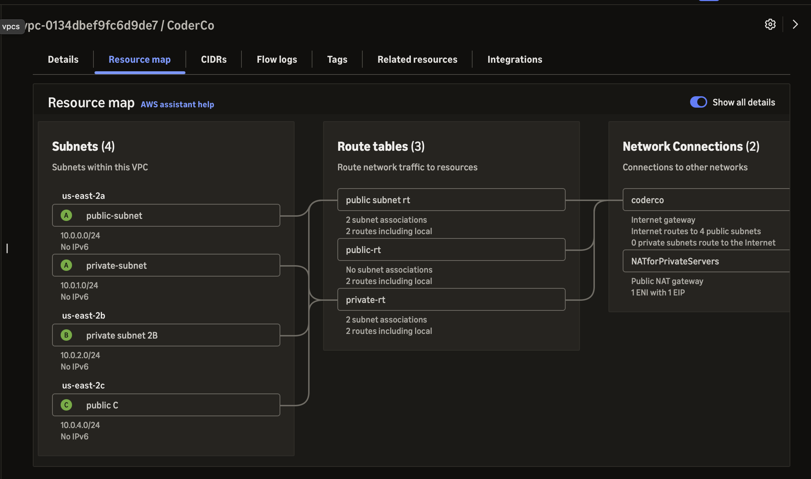
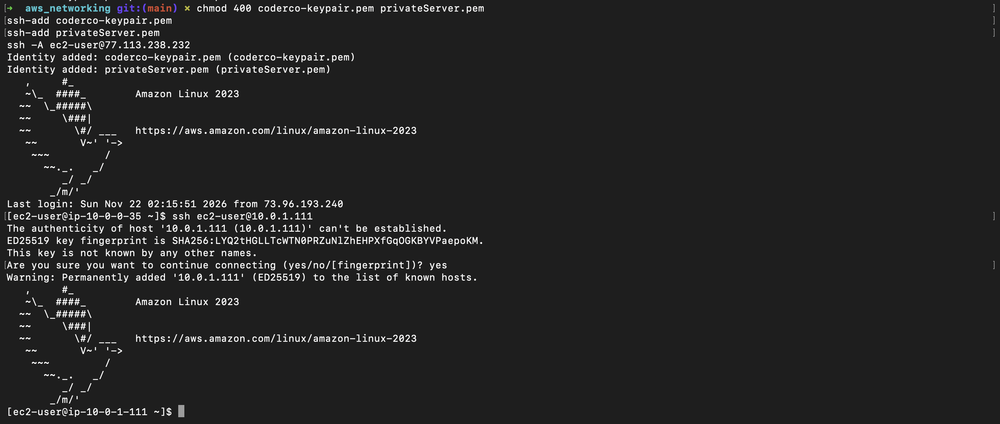
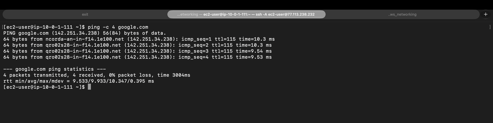
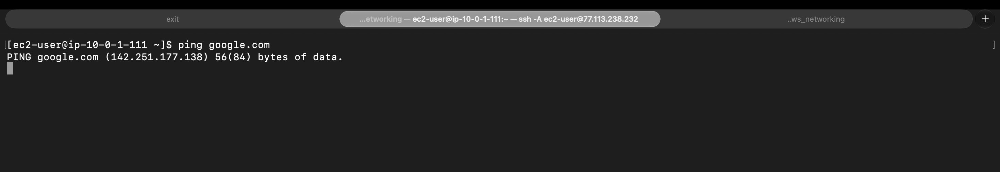

# Assignment 1: VPC & Networking

A custom network built from scratch: a VPC with public and private subnets, routing for internet access, a NAT Gateway for the private tier, and a bastion host for secure access.

## Objective

Create a custom VPC with public and private subnets, set up the correct routing for internet access, and deploy EC2 instances across them.

---

## Network design

**VPC:** `CoderCo` (`10.0.0.0/16`), region `us-east-2`

| Subnet | CIDR | AZ | Type | Route table |
|---|---|---|---|---|
| `public-subnet` | `10.0.0.0/24` | us-east-2a | Public | `public subnet rt` |
| `private-subnet` | `10.0.1.0/24` | us-east-2a | Private | `private-rt` |
| `private subnet 2B` | `10.0.2.0/24` | us-east-2b | Private | `private-rt` |
| `public C` | `10.0.4.0/24` | us-east-2c | Public | `public subnet rt` |

The second public and private subnets were added for Assignment 2, because an ALB needs subnets in at least 2 AZs.

### Gateways

| Component | Name | Placement |
|---|---|---|
| Internet Gateway | `coderco` | Attached to the VPC |
| NAT Gateway | `NATforPrivateServers` | Public subnet, with 1 Elastic IP |

### Route tables

```
public subnet rt   (public-subnet, public C)
  10.0.0.0/16  → local
  0.0.0.0/0    → Internet Gateway

private-rt         (private-subnet, private subnet 2B)
  10.0.0.0/16  → local
  0.0.0.0/0    → NAT Gateway
```

### Security groups

| SG | Inbound | Purpose |
|---|---|---|
| Bastion / public EC2 SG | SSH (22) and HTTP (80) from **my IP only** (`/32`) | Only I can reach the public box |
| Private EC2 SG | SSH (22) from the **bastion's security group** | Private server only accepts SSH from the bastion |

Using the bastion's **security group** as the source (instead of an IP) means the rule keeps working even if the bastion's IP changes.

### EC2 instances

| Instance | Subnet | Public IP | Role |
|---|---|---|---|
| Bastion (`ip-10-0-0-35`) | `public-subnet` | Yes | Jump box |
| Private server (`ip-10-0-1-111`) | `private-subnet` | **No** | Internal server |

The two instances use **different key pairs**.

---

## Accessing the private EC2 through the bastion

I used **SSH agent forwarding**, so the private server's key never gets copied onto the public bastion:

```bash
chmod 400 coderco-keypair.pem privateServer.pem
ssh-add coderco-keypair.pem
ssh-add privateServer.pem
ssh -A ec2-user@<bastion-public-ip>

# inside the bastion
ssh ec2-user@10.0.1.111
```

A cleaner alternative is `ProxyJump` in `~/.ssh/config`:

```
Host bastion
    HostName <bastion-public-ip>
    User ec2-user
    IdentityFile ~/path/to/coderco-keypair.pem

Host private-server
    HostName 10.0.1.111
    User ec2-user
    IdentityFile ~/path/to/privateServer.pem
    ProxyJump bastion
```

Then `ssh private-server` goes through the bastion in one command.

---

## Verification

### 1. VPC resource map
Subnets → route tables → IGW / NAT, as shown in the VPC console.



### 2. Bastion → private EC2
SSH into the bastion (`ip-10-0-0-35`) with agent forwarding, then hop to the private server (`ip-10-0-1-111`).



### 3. Private EC2 reaches the internet through the NAT
The private server has no public IP, but `ping google.com` works because `private-rt` sends outbound traffic to the NAT Gateway.



### 4. No NAT, no internet
With the NAT path removed, the same ping hangs. That proves the NAT is the private subnet's only way out.



---

## Bonus

- [x] Bastion host to access the private EC2
- [ ] CloudWatch monitoring (planned: CPU/status checks, CloudWatch Agent for memory/disk, SSH login alarms on the bastion, VPC Flow Logs for rejected traffic)

---

## What I learned

- **"Public" and "private" are just names until the route table backs them up.** A "private" subnet with no NAT route has no internet at all.
- **Private IPs never leave the VPC.** From a private instance, `curl checkip.amazonaws.com` returns the **NAT's Elastic IP**, not the instance's own IP. From the bastion, it returns the bastion's public IP.
- **Routing decides whether a path exists, and security groups decide whether traffic is allowed.** Both have to agree.
- **Security groups are stateful, NACLs are stateless.** With NACLs you have to allow the return traffic (ephemeral ports 1024–65535) yourself.
- **Never copy private keys onto the bastion.** Use agent forwarding or `ProxyJump`.
- **Next step:** replace the bastion with **SSM Session Manager** (no open port 22, no keys).
