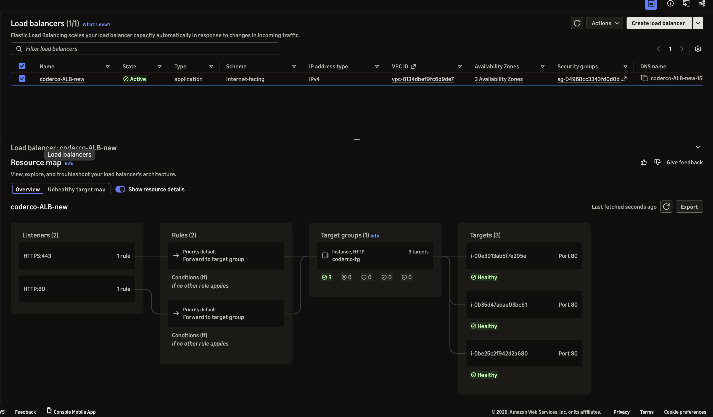
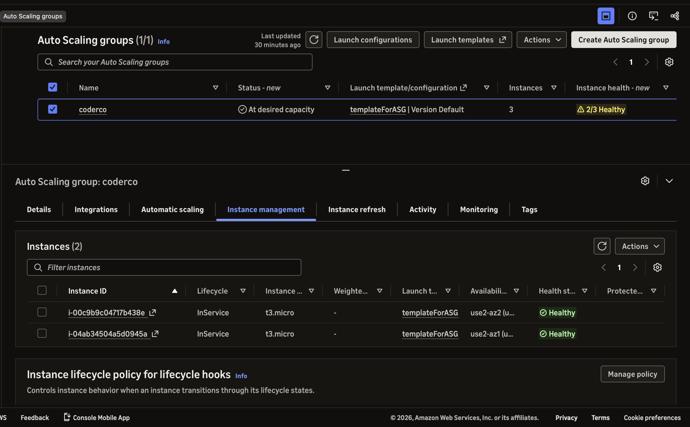
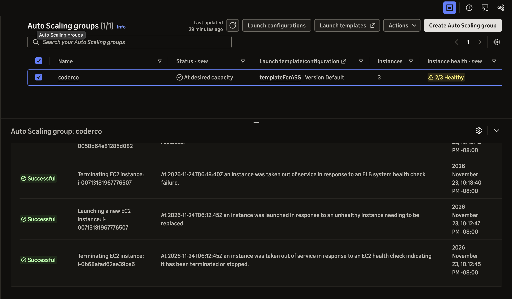
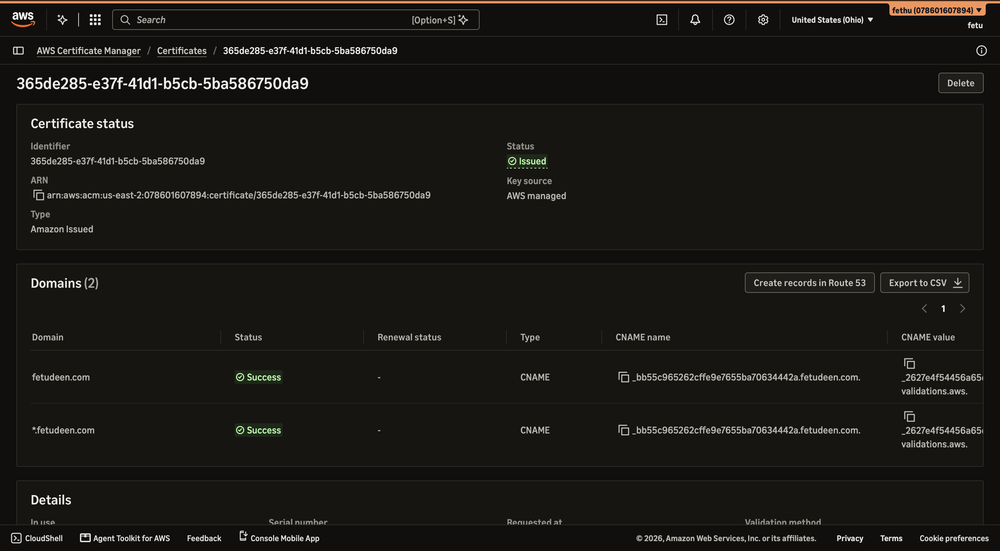
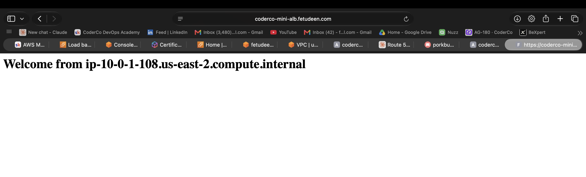
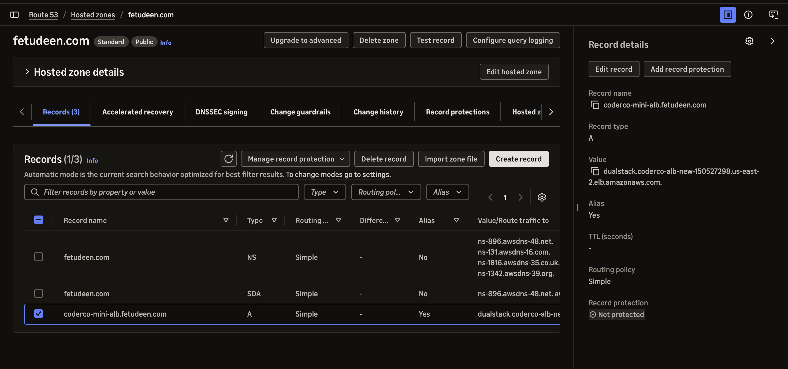
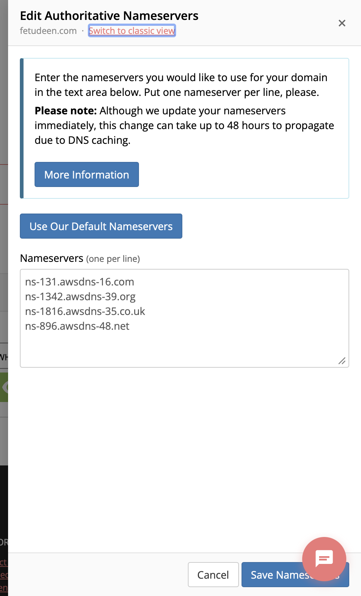

# Assignment 2: Application Load Balancer + Auto Scaling

EC2 instances in private subnets behind an internet-facing ALB, managed by an Auto Scaling Group, served over HTTPS on my own domain.

**Live URL (while running):** `https://coderco-mini-alb.fetudeen.com`

## Objective

Deploy EC2 instances behind an ALB. The ALB handles all incoming traffic, and the instances can't be reached directly from the internet.

---

## Components

| Layer | Resource | Configuration |
|---|---|---|
| DNS | Route 53 hosted zone `fetudeen.com` | Alias **A** record `coderco-mini-alb.fetudeen.com` → ALB |
| Domain | Porkbun | Nameservers delegated to Route 53's 4 `awsdns` servers |
| Certificate | ACM (us-east-2) | `fetudeen.com` + `*.fetudeen.com`, DNS-validated |
| Load balancer | `coderco-ALB-new` | Internet-facing, public subnets |
| Listeners | HTTPS:443 (ACM cert), HTTP:80 | Both forward to `coderco-tg` |
| Target group | `coderco-tg` | Instance targets, HTTP:80, health check `/` → `200` |
| Auto Scaling | `coderco` | Launch template `templateForASG`, private subnets, ELB health checks |
| Instances | t3.micro, Amazon Linux 2023 | Private subnets, **no public IP**, web server via [user data](./user-data.sh) |

### User data

```bash
#!/bin/bash
dnf install -y httpd
echo "<h1>Welcome from $(hostname -f)</h1>" > /var/www/html/index.html
systemctl enable --now httpd
```

Each instance prints its own private hostname, so refreshing the page shows which instance answered. That covers the "different content per instance" requirement automatically.

### Security groups

| SG | Inbound | Why |
|---|---|---|
| ALB SG | 80 and 443 from `0.0.0.0/0` | The ALB is the only public entry point |
| App EC2 SG | 80 from the **ALB SG** | Only the ALB can reach the web server |
| App EC2 SG | 22 from the **bastion SG** | Admin access through the bastion only |

No instance has a public IP or any rule open to the internet.

---

## Request flow

```
1. Browser resolves coderco-mini-alb.fetudeen.com
   → Porkbun delegates to Route 53 → Alias A record → ALB IPs
2. HTTPS connection → Internet Gateway → ALB node in a public subnet (ALB SG allows 443)
3. TLS handshake with the ACM certificate
4. Listener rule → forward to coderco-tg
5. Target group picks a healthy instance (round robin, cross-zone)
6. ALB opens a NEW connection to the instance's private IP on port 80 (App SG allows it from the ALB SG)
7. httpd serves "Welcome from ip-10-0-x-x..."
8. Response goes back through the ALB → IGW → browser
```

Two separate connections are involved: **user ↔ ALB** (HTTPS) and **ALB ↔ instance** (HTTP inside the VPC). The NAT Gateway is never in the user's path. It's only used for the instances' own outbound traffic, like `dnf install` at boot.

---

## Verification

### 1. ALB resource map
Listeners (HTTPS:443, HTTP:80) → rules → `coderco-tg` → 3 healthy targets.



### 2. ASG-managed instances
Instances launched from `templateForASG` across multiple AZs.



### 3. Self-healing
The ASG activity log shows an instance taken out of service after an **ELB health check failure** and a replacement launched automatically.



### 4. ACM certificate
Issued for `fetudeen.com` and `*.fetudeen.com`, validated with DNS records in Route 53.



### 5. HTTPS on my own domain
`https://coderco-mini-alb.fetudeen.com` served by a private instance (`ip-10-0-1-108`).



### 6. Route 53 alias record
`coderco-mini-alb.fetudeen.com` → Alias → `coderco-ALB-new`.



### 7. Porkbun nameservers
Delegated to the same 4 nameservers as the Route 53 hosted zone's NS record.



---

## Bonus

- [x] Route 53 DNS name pointing to the ALB with an **Alias** record
- [x] HTTPS listener with an **ACM** certificate
- [x] **Auto Scaling Group** behind the ALB

---

## Troubleshooting log (real issues I hit)

| Symptom | Root cause | Fix |
|---|---|---|
| ASG instance **unhealthy** in the target group | ASG launched it into a **public** subnet with no public IP, so it had no internet. `dnf install httpd` failed and nothing listened on port 80 | ASG network settings → private subnets only |
| `dig` returned **nothing** for the domain | The Route 53 Alias still pointed to an **old, deleted ALB** | Re-pointed the Alias to `coderco-ALB-new` |
| ALB returned **502 Bad Gateway** | All targets unhealthy, so the ALB "fails open", reaches the instance and finds nothing on port 80 | Fixed user data / network path so httpd starts |
| **Healthy in the ASG, unhealthy in the target group** | ASG only used EC2 status checks, which just confirm the VM is running | Enabled **ELB health checks** + grace period of 180–300s |

### ALB error codes cheat sheet

| Code | Meaning | Where to look |
|---|---|---|
| 503 | No healthy targets | Target group → Targets tab |
| 502 | Reached the instance, but the app refused / bad response | `systemctl status httpd`, `/var/log/cloud-init-output.log` |
| 504 | No reply at all | Security groups / NACLs between the ALB and the instance |

### Debug order (outside → in)

```bash
dig NS fetudeen.com +short                      # delegation OK?
dig coderco-mini-alb.fetudeen.com +short        # alias resolves?
curl -v http://<alb-dns-name>                   # ALB reachable?
# Target group → Targets → "Health status details"
# On the instance (via bastion):
systemctl status httpd && curl localhost
sudo tail -40 /var/log/cloud-init-output.log
```

---

## What I learned

- **The ALB talks to target groups, not instances.** The ASG keeps the target group's list up to date: it registers new instances and deregisters terminated ones.
- **ALB in public subnets, apps in private.** The ALB reaches instances by private IP, so app servers never need a public IP.
- **User data runs once, at first boot, and fails silently.** It needs a working NAT path to install packages.
- **The grace period has to be longer than boot + user data time,** or the ASG kills instances before they're ready (a launch/terminate loop).
- **A wildcard cert (`*.fetudeen.com`) doesn't cover the root domain.** Request both names.
- **Alias records** are the way to point a domain at an ALB: ALB IPs change, and CNAMEs aren't allowed at the root domain.

## Next steps

- Redirect HTTP:80 → HTTPS:443 instead of forwarding both
- Target tracking scaling policy (ALB request count per target) and load test with `hey`
- CloudWatch dashboard and alarms (HealthyHostCount, ELB vs target 5XX)
- Rebuild the whole stack in **Terraform**
